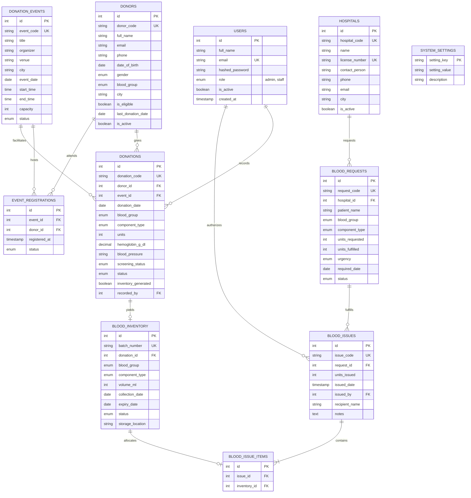

# Entity-Relationship (ER) Diagram — Blood Donation Management System

This document outlines the entity relationships, primary/foreign keys, cardinality, and constraints designed for `blood_donation_db`.

## Relationship Cardinalities Summary
- **DONOR to DONATIONS**: One-to-Many (`1 : N`). A donor can donate multiple times over their lifetime, respecting the mandatory gap interval.
- **DONATION to BLOOD_INVENTORY**: One-to-One (`1 : 1`) for standard component units or `1 : N` if separated into components. In this project, each approved donation batch generates a tracked inventory record.
- **HOSPITAL to BLOOD_REQUESTS**: One-to-Many (`1 : N`). A hospital issues multiple discrete blood requests.
- **BLOOD_REQUEST to BLOOD_ISSUES**: One-to-Many (`1 : N`). A request for 3 units may be fulfilled across multiple deliveries (partial fulfillment) or a single dispatch.
- **BLOOD_ISSUES to BLOOD_INVENTORY**: Many-to-Many via `BLOOD_ISSUE_ITEMS` associative junction table. This enforces batch-level traceability for audits.
- **DONATION_EVENTS to EVENT_REGISTRATIONS to DONORS**: Many-to-Many bridge allowing donors to pre-register for mobile community drives.
